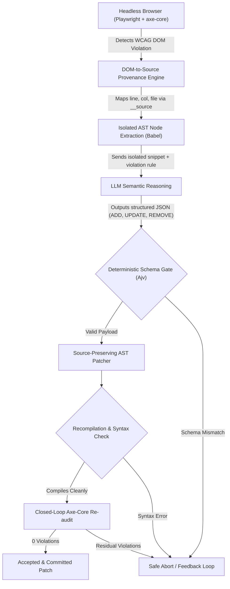

# AccessAudit

[](https://github.com/Kartik-idk/AccessAudit/actions)
[](https://www.typescriptlang.org/)
[](LICENSE)

An AI-assisted accessibility remediation research prototype that pairs constrained LLM code proposals with deterministic DOM-to-source provenance, AST-level validation, and closed-loop browser verification.

---

## Prototype Interface


---

## Problem Statement

Automated web accessibility remediation powered by modern Large Language Models (LLMs) faces critical engineering hurdles:
1. **Unconstrained Code Corruption:** Directly asking an LLM to rewrite large component files introduces syntax errors, breaks unrelated business logic, or hallucinates external imports.
2. **DOM-to-Source Disconnect:** Accessibility violation engines (`axe-core`, Lighthouse) report failures on rendered browser DOM nodes, while developers work on source JSX/TSX templates.
3. **Unverified Claims:** Generating code without automated browser re-testing leaves subtle WCAG regressions undetected.

**AccessAudit** enforces a strict separation of concerns:
> **The LLM proposes structured operations. Deterministic AST gates validate and apply. Headless browser verification closes the loop.**

---

## Architecture & Remediation Pipeline

The system routes accessibility violations through a nine-stage constrained verification pipeline:



### Key Technical Decisions

- **DOM-to-Source Provenance:** Uses a custom Vite compiler plugin (`patch_extractNodes.cjs`) and Babel AST tagging to inject `__source` coordinates into runtime DOM elements.
- **Constrained Operation Schema:** The LLM is restricted from generating raw source code. It must emit a strict JSON schema consisting of atomic operations: `ADD`, `UPDATE`, `REMOVE`, or `REPLACE_TAG`.
- **Source-Preserving AST Manipulation:** Babel AST traversal modifies only the targeted JSX attributes and children, preserving developer formatting, comments, and untargeted logic.
- **Closed-Loop Verification:** Re-runs Playwright and axe-core in a headless browser loop to verify that the targeted violation was eliminated without introducing regressions.
- **Safe Abort Mechanism:** If a remediation requires out-of-scope context or business logic alterations, the model emits a structured `ABORT` signal, gracefully halting rather than hallucinating.

---

## Technology Stack

| Layer | Technologies |
| :--- | :--- |
| **Runtime & Language** | Node.js (v20+), TypeScript, ECMAScript Modules |
| **DOM Auditing** | `playwright`, `axe-core`, `@axe-core/playwright` |
| **AST Parsing & Patching** | `@babel/parser`, `@babel/traverse`, `@babel/generator`, `@babel/types` |
| **Validation** | `ajv` (JSON Schema Validator), `html-validate` |
| **Frontend Prototype** | React 19, Vite 8, Tailwind CSS |
| **Backend & Prototype Server** | Express 5, CORS |

---

## Local Development & Setup

### Prerequisites

- Node.js 20+ installed
- npm 10+ installed

### Installation

1. **Clone repository:**
   ```bash
   git clone https://github.com/Kartik-idk/AccessAudit.git
   cd AccessAudit
   ```

2. **Install dependencies:**
   ```bash
   npm ci
   ```

3. **Start prototype interface:**
   ```bash
   npm run prototype
   ```
   This concurrently runs the Vite dev server (`http://localhost:5173`) and the prototype backend runner (`http://localhost:3001`).

---

## Testing & Verification

- **Automated Protocol Engine Suite (Controls A-K):**
  ```bash
  npm test
  ```
- **TypeScript Typecheck:**
  ```bash
  npx tsc --noEmit
  ```

---

## Research Status & Realistic Boundaries

- **Task 30 Offline Semantic Benchmark:** In controlled semantic benchmark tests, the fine-tuned model matched the semantic ground truth in **43 of 50** localized cases.
- **Scope & Limitations:** AccessAudit is an active research prototype. The offline semantic benchmark measures localized component tagging and property mapping; it does **not** establish 100% end-to-end autonomous patch application or universal production build safety.

---

## Documentation

- [Detailed System Architecture](docs/ARCHITECTURE.md)
- [Reproducibility Guidelines](docs/REPRODUCIBILITY.md)
- [Benchmark Results](docs/BENCHMARK.md)
- [Research Status Report](docs/RESEARCH_STATUS.md)

---

## License

See [LICENSE](LICENSE) for research licensing notices and terms.
